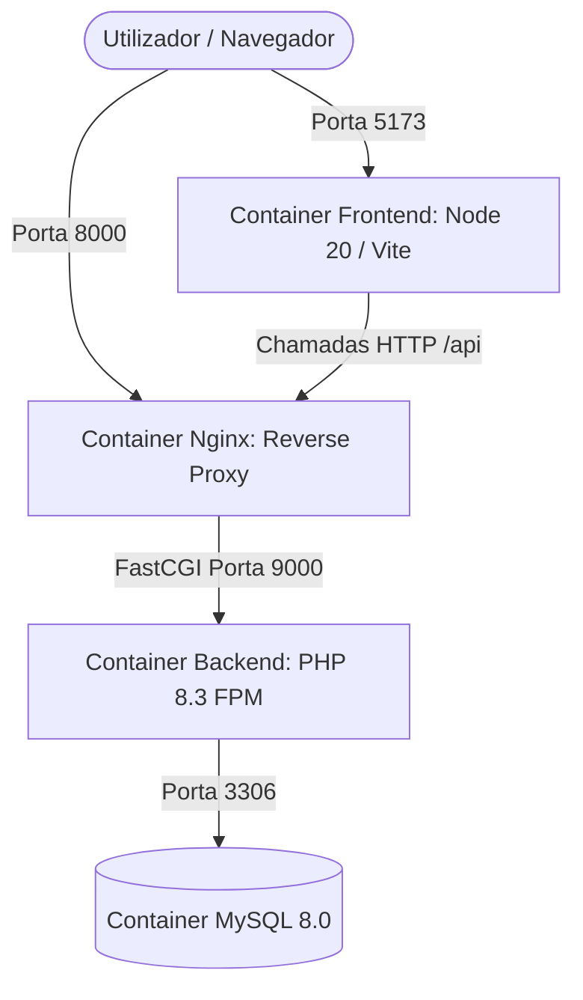

# 🚀 Web Projects Starter Template

[](https://github.com/opaulosilva233/Web-Projects-Template/actions/workflows/ci.yml)
[](https://www.docker.com/)
[](https://laravel.com/)
[](https://react.dev/)
[](https://tailwindcss.com/)
[](https://www.mysql.com/)
[](https://nginx.org/)
[](LICENSE)

Starter template profissional, desacoplado e opinativo projetado para acelerar a criação de novas aplicações web modernas. Com apenas um comando (`make setup`), o ambiente completo com backend, frontend, base de dados e proxy reverso fica 100% configurado e pronto para desenvolvimento.

---

## 📑 Índice

1. [O que é este Template](#1-o-que-é-este-template)
2. [Stack Tecnológica](#2-stack-tecnológica)
3. [Estrutura do Projeto](#3-estrutura-do-projeto)
4. [Pré-requisitos](#4-pré-requisitos)
5. [Quick Start (Início Rápido)](#5-quick-start-início-rápido)
6. [Comandos do Makefile](#6-comandos-do-makefile)
7. [Configuração de Variáveis de Ambiente (.env)](#7-configuração-de-variáveis-de-ambiente-env)
8. [Ambiente Docker & Arquitetura](#8-ambiente-docker--arquitetura)
9. [Fluxo de Desenvolvimento](#9-fluxo-de-desenvolvimento)
10. [Testes & Qualidade de Código](#10-testes--qualidade-de-código)
11. [Integração Contínua (CI)](#11-integração-contínua-ci)
12. [Como Utilizar como GitHub Template](#12-como-utilizar-como-github-template)

---

## 1. O que é este Template

Este repositório é uma base sólida para novos projetos fullstack desacoplados (**Decoupled Monorepo**). Ele resolve as fricções comuns de configuração inicial:
- Orquestração de containers com Docker Compose e healthchecks configurados.
- Backend estruturado como API RESTful em Laravel 11 com tipagem estrita e padrões modernos.
- Frontend em React com Vite, TypeScript e Tailwind CSS integrado a um cliente de API centralizado.
- Automação completa via Makefile para execução simplificada sem necessidade de instalar PHP, Composer ou Node no host.
- Pipeline de CI pronto no GitHub Actions para validação de testes e estilo de código.

---

## 2. Stack Tecnológica

| Componente | Tecnologia | Papel no Projeto |
| :--- | :--- | :--- |
| **Backend API** | **Laravel 11 / PHP 8.3 FPM** | Endpoints RESTful, ORM Eloquent, autenticação Sanctum |
| **Frontend SPA** | **React 18 / TypeScript / Vite** | Interface reativa, moderna e tipada |
| **Estilização** | **Tailwind CSS 3.4** | Design system e classes utilitárias |
| **Web Server** | **Nginx Alpine** | Reverse proxy otimizado para o backend PHP-FPM |
| **Base de Dados** | **MySQL 8.0** | Persistência relacional com volume Docker |
| **Orquestração** | **Docker & Docker Compose** | Ambientes isolados e reprodutíveis |
| **Automação** | **GNU Make & Bash** | Gestão de ciclo de vida e setup com 1 comando |
| **CI/CD** | **GitHub Actions** | Validação automatizada de testes e lint |

---

## 3. Estrutura do Projeto

```text
├── .github/
│   └── workflows/
│       └── ci.yml               # Pipeline de CI do GitHub Actions
├── backend/                     # API RESTful em Laravel 11 (PHP 8.3)
│   ├── app/                     # Controllers, Models, Requests, Resources
│   ├── bootstrap/               # Inicialização da aplicação (app.php, providers.php)
│   ├── config/                  # Configurações de CORS, Sanctum, Database, etc.
│   ├── database/                # Migrações e Seeders
│   ├── routes/                  # Rotas da API (api.php, web.php, console.php)
│   ├── tests/                   # Testes automatizados (Feature & Unit)
│   ├── composer.json            # Dependências PHP do Backend
│   └── pint.json                # Configuração do linter Laravel Pint
├── frontend/                    # Single Page Application (React + Vite + TypeScript)
│   ├── src/
│   │   ├── services/            # Cliente HTTP (api.ts) configurado
│   │   ├── types/               # Tipos e interfaces TypeScript
│   │   ├── App.tsx              # Componente raiz com verificação de status
│   │   ├── index.css            # Diretivas do Tailwind CSS
│   │   └── main.tsx             # Ponto de entrada do React
│   ├── package.json             # Dependências Node.js
│   ├── vite.config.ts           # Configurações do Vite
│   └── tailwind.config.js       # Configuração do Tailwind CSS
├── docker/
│   ├── nginx/
│   │   └── default.conf         # Configuração do Nginx com suporte a PHP-FPM
│   └── php/
│       ├── Dockerfile           # Imagem PHP 8.3 FPM Alpine com extensões
│       └── local.ini            # Ajustes de memória, opcache e limites do PHP
├── scripts/
│   └── setup.sh                 # Script de setup e verificação do ambiente
├── .env.example                 # Modelo de variáveis de ambiente do projeto
├── .gitignore                   # Regras de exclusão do Git
├── AGENT_SKILLS.md              # Diretrizes estritas para Agentes de IA
├── docker-compose.yml           # Definição multi-container dos serviços
├── Makefile                     # Atalhos de automação para o terminal
└── README.md                    # Documentação do projeto
```

---

## 4. Pré-requisitos

Para executar o projeto, você precisa apenas de:
- **Docker Desktop** (versão 24.0 ou superior) ou **Docker Engine** + **Docker Compose v2**
- **Make** (nativo em Linux/macOS, ou disponível via Git Bash / WSL no Windows)

> 💡 *Nota:* Não é necessário ter PHP, Composer ou Node.js instalados na sua máquina física. Todo o ambiente de execução roda dentro dos containers Docker.

---

## 5. Quick Start (Início Rápido)

Com o repositório clonado, inicialize o ambiente completo em um único comando:

```bash
# 1. Clonar o projeto
git clone https://github.com/opaulosilva233/Web-Projects-Template.git meu-projeto
cd meu-projeto

# 2. Executar o setup automático
make setup

# Alternativa no Windows sem make (Git Bash / WSL):
# bash scripts/setup.sh
```

O comando `make setup` é **idempotente** e realiza automaticamente:
1. Verificação da disponibilidade do Docker e Docker Compose.
2. Criação do `.env` a partir de `.env.example` (sem sobrescrever se já existir) e montagem do mesmo ficheiro no backend Laravel.
3. Construção das imagens e inicialização dos containers em background.
4. Espera pelo healthcheck da base de dados MySQL.
5. Instalação das dependências via Composer e NPM dentro dos containers.
6. Geração da chave `APP_KEY` do Laravel.
7. Execução das migrações de banco de dados.

### Aceder à Aplicação

Assim que o setup for concluído, abra o navegador:

| Serviço | URL | Descrição |
| :--- | :--- | :--- |
| 🌐 **Frontend (React)** | [http://localhost:5173](http://localhost:5173) | Interface do utilizador (SPA) |
| 🔌 **Backend (API)** | [http://localhost:8000](http://localhost:8000) | Ponto de entrada da API Nginx/Laravel |
| 🩺 **API Healthcheck** | [http://localhost:8000/api/health](http://localhost:8000/api/health) | Verificação de status JSON da API e DB |
| 🗄️ **MySQL Database** | `localhost:3306` | Acesso direto ao banco de dados |

---

## 6. Comandos do Makefile

O `Makefile` centraliza todos os comandos necessários para o fluxo de trabalho:

```text
make setup           Prepara e inicializa todo o ambiente automaticamente
make up              Inicia todos os containers em background
make down            Para e remove os containers e redes
make restart         Reinicia todos os containers
make build           Reconstrói as imagens Docker
make logs            Exibe os logs agregados em tempo real (Ctrl+C para sair)
make ps              Lista o status e a saúde de todos os containers
make shell           Abre o terminal interativo no container do Backend (PHP)
make shell-frontend  Abre o terminal interativo no container do Frontend (Node)
make install         Instala dependências do backend (Composer) e frontend (NPM)
make test            Executa todas as suites de testes (Backend + Frontend)
make test-backend    Executa a suite de testes no Laravel (PHPUnit/Pest)
make test-frontend   Executa os testes do frontend (se configurados)
make lint            Executa a verificação de código (Pint e ESLint)
make lint-backend    Verifica/corrige estilo de código no Laravel via Pint
make lint-frontend   Executa o linter no Frontend via ESLint
make migrate         Executa migrações pendentes do Laravel
make fresh           Recria a base de dados do zero e executa seeders (migrate:fresh --seed)
make seed            Executa os seeders de dados no Laravel
```

---

## 7. Configuração de Variáveis de Ambiente (.env)

O ficheiro `.env.example` traz configurações padronizadas prontas para uso local:

```dotenv
# Nome do projeto usado como prefixo para containers Docker
COMPOSE_PROJECT_NAME=starter_template

# Portas mapeadas no Host
NGINX_PORT=8000
FRONTEND_PORT=5173
DB_PORT=3306

# Configuração da Base de Dados
DB_CONNECTION=mysql
DB_HOST=db
DB_PORT=3306
DB_DATABASE=app_database
DB_USERNAME=app_user
DB_PASSWORD=secret_password
DB_ROOT_PASSWORD=root_secret_password

# Backend / Laravel
APP_NAME="Web Project Template"
APP_ENV=local
APP_KEY=
APP_DEBUG=true
APP_URL=http://localhost:8000
FRONTEND_URL=http://localhost:5173

# Frontend / Vite
VITE_API_BASE_URL=http://localhost:8000/api
```

---

## 8. Ambiente Docker & Arquitetura

Os serviços estão orquestrados no `docker-compose.yml`:



- **Sincronização de Código em Tempo Real:** As pastas `backend/` e `frontend/` possuem bind mount com os containers. Qualquer alteração em código reflete instantaneamente (com Hot Module Replacement no Vite).
- **Isolamento de `node_modules`:** O frontend utiliza um volume anônimo para `node_modules`, evitando incompatibilidades de binários entre sistemas operacionais host e o container Linux Alpine.
- **Healthcheck Integrado:** O container `db` possui healthcheck ativo com `mysqladmin ping`, garantindo que o backend só inicializa conexões quando o MySQL estiver totalmente pronto.

---

## 9. Fluxo de Desenvolvimento

### Criar uma nova rota / endpoint no Backend:
1. Defina a rota em `backend/routes/api.php`.
2. Crie o Form Request para validação se aplicável:
   ```bash
   docker compose exec backend php artisan make:request Feature/StoreItemRequest
   ```
3. Crie o Controller e o Resource:
   ```bash
   docker compose exec backend php artisan make:controller Api/ItemController
   docker compose exec backend php artisan make:resource Feature/ItemResource
   ```

### Consumir a API no Frontend:
1. Importe o cliente configurado em `frontend/src/services/api.ts`:
   ```typescript
   import { api } from './services/api';
   import { ApiResponse } from './types';

   const response = await api.get<ApiResponse<YourType>>('/items');
   ```

---

## 10. Testes & Qualidade de Código

Para garantir a confiabilidade da aplicação:

```bash
# Executar todos os testes
make test

# Executar apenas testes do Backend
make test-backend

# Executar linters de código
make lint
```

- **Backend:** Testes com PHPUnit / Pest configurados com SQLite em memória para rapidez máxima. Estilo padronizado com **Laravel Pint**.
- **Frontend:** Verificação de tipos com TypeScript (`tsc -b`) e linting via **ESLint**.

---

## 11. Integração Contínua (CI)

O workflow do GitHub Actions em `.github/workflows/ci.yml` roda automaticamente em cada `push` ou `pull_request` nas branches `main` e `develop`:
- **Job Backend:** Inicializa PHP 8.3, instala dependências com cache de Composer, sobe serviço MySQL 8.0, roda migrações, valida estilo com Pint e executa a suite de testes.
- **Job Frontend:** Inicializa Node.js 20, instala pacotes com cache de NPM, executa linter e valida o build de produção (`npm run build`).

---

## 12. Como Utilizar como GitHub Template

1. No GitHub, clique no botão verde **"Use this template"** > **"Create a new repository"**.
2. Defina o nome do seu novo projeto e clone-o para a sua máquina:
   ```bash
   git clone https://github.com/<seu-usuario>/<seu-novo-projeto>.git
   cd <seu-novo-projeto>
   ```
3. Execute o setup inicial:
   ```bash
   make setup
   ```
4. Comece a programar imediatamente! 🚀

---

## 📄 Licença

Este projeto está sob a licença [MIT](LICENSE). Sinta-se à vontade para usá-lo em projetos pessoais e comerciais.
